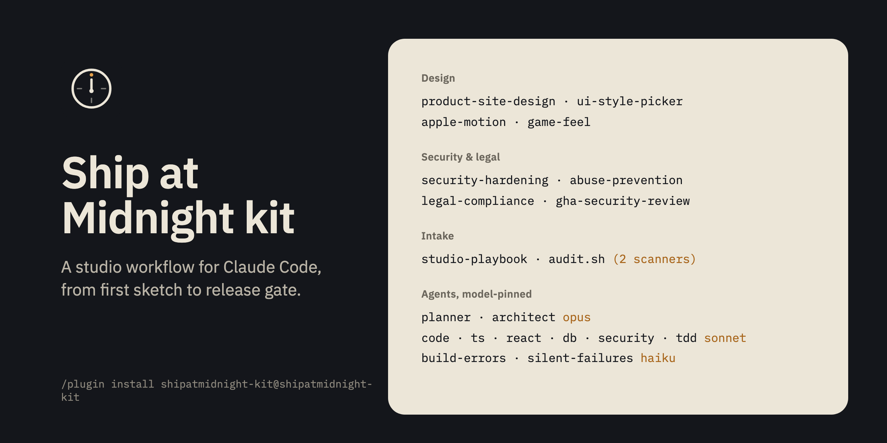

<p align="center"></p>

<h1 align="center">Ship at Midnight kit</h1>

<p align="center">A Claude Code plugin that takes a one-paragraph product idea to a release gate: plan, build, review, secure, document, then stop and ask you.</p>

<p align="center"></p>

> Free, as-is, with no warranty. Nothing here is legal or security advice. Not affiliated with Anthropic; Claude and Claude Code are trademarks of Anthropic, PBC.

## 60-second quickstart

```
/plugin marketplace add shreyassaw5394/shipatmidnight-kit
/plugin install shipatmidnight-kit@shipatmidnight-kit
/vision "A tiny CLI that turns a folder of markdown notes into a static site with search, no config, one command."
```

Then go make coffee. When you come back there is a ship gate waiting for your decision.

`/vision` also works as `/shipatmidnight-kit:vision` if another plugin has a skill with the same name. From a terminal: `claude plugin marketplace add shreyassaw5394/shipatmidnight-kit` then `claude plugin install shipatmidnight-kit@shipatmidnight-kit`. To try without installing: clone the repo and run `claude --plugin-dir ./shipatmidnight-kit`.

## What happens when you run /vision

1. **Preflight.** Checks you are in a git repo (or inits one), refuses to run against a repo whose remote is already public, checks that GSD is installed (if not, it prints the one install command and stops), and writes `.planning/VISION.md` and a state file so the run can resume.
2. **Path choice.** Says which path it is taking and why. Ground-up work (a new project, a big new phase) goes through GSD. A small local task (a fix, a doc edit, a config change, a single-file feature) is done directly or with one small agent, with no planner or executor ceremony.
3. **Name knockout check.** Looks the name up on npm, PyPI, GitHub and the web if a search tool is available, and records the date. A same-name hit in the same category is the one thing it will stop and ask about. This is a scripted search, not a trademark clearance.
4. **GSD in auto mode.** Writes a lean `.planning/config.json` (yolo, quick depth, balanced model profile, 3 concurrent agents) and runs `/gsd:new-project --auto` on your paragraph. GSD then discusses, plans and executes each phase on its own. One plan-check round, not three. Executors follow the `token-economy` rules: 2-3 in parallel, the mid model for execution, the small model for mechanical fixes, a commit lock so parallel commits don't clobber each other. GSD 1.20.4 asks three setup questions in auto mode; the skill answers with the defaults already written to its config. In a non-interactive `claude -p` run it did not block: the questions were answered with those defaults (checked once, 2026-11-04). In an interactive session, if they appear, press enter three times.
5. **Review, security, legal.** A code-review agent over the full diff, the `security-hardening` pass (plus `abuse-prevention` where there are endpoints and `gha-security-review` where there are workflows), a secret scan with gitleaks, and the `legal-compliance` pass (licences in every distributable, a claims audit of every README and page, "free, as-is" wording, consent before tracking, accessibility basics).
6. **Face and words.** An original SVG logo, an intro image rendered from HTML, a README, and a product page draft built with `product-site-design`.
7. **Ship gate.** Writes and prints `.planning/SHIP-GATE.md` with four parts: what was verified (each command and its result), what this flow cannot verify (real users, production, trademark, legal sufficiency, taste), the decisions only you can make, and the next taps. **Then it stops.** It never pushes to a public remote, publishes a package, deploys, or creates a public repo. Those are your taps.

`/vision status` shows where a run is. `/vision resume` picks up after a usage limit or a closed session without restarting finished steps.

What it cannot do: judge taste, clear a name, confirm a policy fits the law, test with real users, or see production. Scanners and checklists are a floor, not a guarantee, and the gate says so every time.

## What's inside

### Skills

| Skill | What it does |
|---|---|
| `vision` | The `/vision` flow above: one paragraph in, a ship gate out. |
| `studio-playbook` | Loads the operating rules ([PLAYBOOK.md](PLAYBOOK.md)) at the start of builds, releases and installs. |
| `token-economy` | Lean multi-agent and GSD runs: ceremony only for ground-up work, 2-3 agents, model per task, short prompts, scoped tests, short reports, a safe parallel-commit recipe, resume after a usage limit. |
| `product-site-design` | Design-first process for any site or UI: the product is the hero, restraint, real material, and the gates every page passes. |
| `ui-style-picker` | Names a visual style before building, writes a six-line style spec, checks contrast per style. Includes a contrast checker script. |
| `apple-motion` | Fluid, physical interface motion for the web (springs, gestures, interruptible transitions, reduced motion). |
| `game-feel` | "Juice" for games: hit-stop, screen shake, easing, squash and stretch, layered feedback. |
| `security-hardening` | Repo and supply chain, HTTP headers, auth, leakage, local-only servers, MCP servers, VS Code extensions, CI publishing. |
| `abuse-prevention` | Rate limits, cost caps, SSRF-safe fetching, spam and AI-specific abuse. Includes `safeFetch.ts` and a framework-neutral `rateLimit.ts`, with tests. |
| `legal-compliance` | Consent before tracking, policies, age gates, licences in every distributable, claims audit, accessibility, AI disclosure. Includes a privacy probe and a third-party licence generator. |
| `gha-security-review` | Exploit-focused review of GitHub Actions workflows. |

### Agents (model-pinned)

| Agent | Model | Use it for |
|---|---|---|
| `ecc-planner`, `ecc-architect` | opus | Plans and architecture decisions |
| `ecc-code-reviewer`, `ecc-typescript-reviewer`, `ecc-react-reviewer`, `ecc-database-reviewer`, `ecc-security-reviewer`, `ecc-tdd-guide` | sonnet | Review, security, database and test-first work |
| `ecc-build-error-resolver`, `ecc-silent-failure-hunter` | haiku | Getting the build green; finding swallowed errors |

### Playbook and scanners

- [PLAYBOOK.md](PLAYBOOK.md): the eleven rules the skills enforce, in plain words (design first, plan then build, test before commit, neutral wording for security and legal fixes, nothing public without the owner, release gates, skill intake, model per task, every repo gets a face, saving tokens with GSD).
- `tools/skill-audit/audit.sh` runs NVIDIA SkillSpector and SkillEvaluator (fetched at pinned tags on first run, not bundled) on any skill folder or agent file. `tools/skill-audit/POLICY.md` is the intake and anti-bloat policy. Every skill and agent in this repo was scanned with both before publishing; see [SECURITY-SCAN.md](SECURITY-SCAN.md).

## How it saves tokens

Usage limits stop every running agent at once, so the kit runs lean on purpose. The rules are in the `token-economy` skill and the "Saving tokens with GSD" section of the playbook:

- No planner, plan-check or executor ceremony for small local tasks; GSD only for ground-up work.
- At most 2-3 agents in parallel, never six.
- The frontier model only where a wrong call is expensive to undo (planning, architecture, taste); the mid model for execution and review; the small model for mechanical fixes.
- Executor prompts are pointers (plan path, conventions file, one or two summaries), not briefings.
- Scoped tests per commit, the full suite once per wave.
- Reports are three lists: changed, unverified, owner decisions.
- After a limit hit, stopped agents are resumed by message, not restarted.

No savings figure is quoted here because none has been measured with a repeatable method.

## Requirements

- Claude Code 2.1 or newer (the kit was checked with 2.1.310; plugin skills with arguments and `claude plugin validate` are used).
- For `/vision`: GSD (get-shit-done) installed globally at the pinned version: `npx get-shit-done-cc@1.20.4 --claude --global`. Upstream [gsd-build/get-shit-done](https://github.com/gsd-build/get-shit-done/tree/v1.20.4) (MIT) is **archived** as of May 2026; the pinned version works but will not receive fixes, and its update-check hook polls the archived package, so leave that hook off. The maintained fork is [open-gsd/gsd-core](https://github.com/open-gsd/gsd-core) (MIT); scan it with `audit.sh` before adopting. GSD is linked, not bundled, because its installer writes absolute paths into the agent files.
- Optional, used when present: `gitleaks` for secret scans, `gh` for the repo-visibility and GitHub name checks, a headless browser for rendering the intro image, `git`, `uv` and `python3` for `audit.sh`.

## Recommended companions (linked, not bundled)

Part of the same workflow, installed from their own repos at the pinned commit. Scan each with `audit.sh` first.

| What | Where (pinned) | Licence | Why it's linked, not bundled |
|---|---|---|---|
| karpathy-guidelines (coding behaviour) | [multica-ai/andrej-karpathy-skills @ 2c60614](https://github.com/multica-ai/andrej-karpathy-skills/tree/2c606141936f1eeef17fa3043a72095b4765b9c2) | MIT stated in README/manifest; no LICENSE file | Ships its own plugin marketplace |
| taste-skill (art direction, inspector) | [Leonxlnx/taste-skill @ 12af471](https://github.com/Leonxlnx/taste-skill/tree/12af471f627f866411b4bd785b19646d3672784c) | MIT | Large and changes often; downloaded photos and fonts carry their own licences |
| image-to-code | [Leonxlnx/imagegen-skills @ beb16b0](https://github.com/Leonxlnx/imagegen-skills/tree/beb16b0d0f4dae9a6f5cb04ea41e97b93a54ab8e) | MIT | Needs an image-generation tool |
| awesome-design-md (reference design systems) | [VoltAgent/awesome-design-md @ fcc7028](https://github.com/VoltAgent/awesome-design-md/tree/fcc70284932276d085f01ef9f83edde90b1258cb) | MIT | Contains other brands' design descriptions; use for principles only |
| web-design-guidelines | [vercel-labs/agent-skills @ 1a2c79d](https://github.com/vercel-labs/agent-skills/tree/1a2c79d4e6c4a2283dc2c614b6538cbe1ed5ca62) · guidelines: [vercel-labs/web-interface-guidelines @ 434b7f9](https://github.com/vercel-labs/web-interface-guidelines/tree/434b7f91364665f2f733b310ec54809bf8f37937) | README says MIT, no LICENSE file · MIT | Licence file missing upstream; fetches live guidelines anyway |
| playwright-cli (browser testing) | [microsoft/playwright-cli @ v0.1.23](https://github.com/microsoft/playwright-cli/tree/v0.1.23) | Apache-2.0 | Install with npm |
| supabase, supabase-postgres-best-practices | [supabase/agent-skills @ v0.1.9](https://github.com/supabase/agent-skills/tree/v0.1.9) | MIT | Updated often upstream |
| legal-suite picks | [anthropics/claude-for-legal @ 4a6c651](https://github.com/anthropics/claude-for-legal/tree/4a6c651889c97cc9140580363c73e0eb17379c2b) | Apache-2.0 | Official upstream plugin |
| security-audit | [cloudflare/security-audit-skill @ c1c8a8c](https://github.com/cloudflare/security-audit-skill/tree/c1c8a8c1471069fb0e188eeaff69b8e8db6564a8) | MIT | Upstream skill |
| NVIDIA SkillSpector / SkillEvaluator | [SkillSpector v2.13.3](https://github.com/NVIDIA/SkillSpector/tree/v2.13.3) · [SkillEvaluator v0.7.1](https://github.com/NVIDIA/SkillEvaluator/tree/v0.7.1) | Apache-2.0 | Fetched by `audit.sh` at run time |
| Debug Anything (runtime observation for agents: MCP server + skill) | [shreyassaw5394/debuganything @ 925fd9d](https://github.com/shreyassaw5394/debuganything/tree/925fd9df5ff7e25a4d1df0cdbd943f640a8e0dd9) | MIT | Ships as its own plugin with the MCP server it needs |
| Agent Theatre (watch and replay agent sessions) | [shreyassaw5394/agent-theatre @ v1.8.1](https://github.com/shreyassaw5394/agent-theatre/tree/v1.8.1) | MIT | Ships as its own plugin with hooks |

Not included on purpose: Sentry's `skill-scanner` (overlaps with `audit.sh`; get it from [getsentry/skills](https://github.com/getsentry/skills) if you want it), Apple HIG-derived design-review skills (unlicensed upstream, Apple-copyrighted text), account-synced Anthropic skills, any personal settings, memory, hooks or keys.

## Licences and credits

The kit's own files are MIT ([LICENSE](LICENSE)). Bundled third-party pieces keep their own licences, with LICENSE and NOTICE files in their folders and in `THIRD_PARTY/`. [THIRD_PARTY_NOTICES.md](THIRD_PARTY_NOTICES.md) is the authoritative list; in short:

| Bundled piece | From | Licence |
|---|---|---|
| `agents/ecc-*.md` (10 agents) | [affaan-m/ECC](https://github.com/affaan-m/ECC), (c) 2026 Affaan Mustafa | MIT |
| `skills/game-feel` | [gamedev-skills/awesome-gamedev-agent-skills](https://github.com/gamedev-skills/awesome-gamedev-agent-skills), (c) 2026 Abhishek Barali and contributors | Apache-2.0 |
| `skills/gha-security-review` | [getsentry/skills](https://github.com/getsentry/skills) | Apache-2.0 |
| `skills/apple-motion` | [emilkowalski/skills](https://github.com/emilkowalski/skills), (c) 2026 Emil Kowalski | MIT |
| `skills/ui-style-picker/references/ui-ux-pro-max-styles.csv` | [nextlevelbuilder/ui-ux-pro-max-skill](https://github.com/nextlevelbuilder/ui-ux-pro-max-skill), (c) 2024 Next Level Builder | MIT |

Ideas paraphrased with inline credit (no text or code copied) in the legal, security and abuse skills: Anthropic claude-for-legal, Sentry skills, OpenAI security skills, supabase/agent-skills, github/awesome-copilot, Addy Osmani web-quality-skills, Trail of Bits skills, Semgrep llm-security, OWASP and W3C publications. The intro image was rendered with IBM Plex Sans and IBM Plex Mono (SIL OFL 1.1); no font files are distributed.

Made by Shreyas Sawant. Companion products by the same author: Debug Anything and Agent Theatre (linked above).

Names of companies and products (Anthropic, Claude, Apple, Sentry, NVIDIA, Vercel, Supabase, GitHub, Microsoft and others) are used only to identify them; no affiliation with or endorsement by any of them is implied. Claude and Claude Code are trademarks of Anthropic, PBC. The kit is free, provided as-is, and is not legal or security advice.
